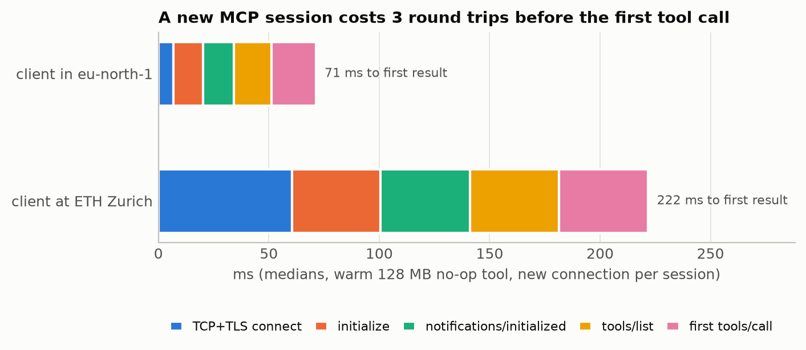
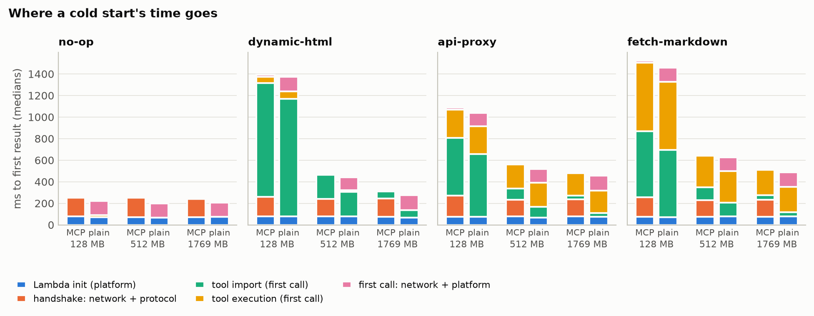
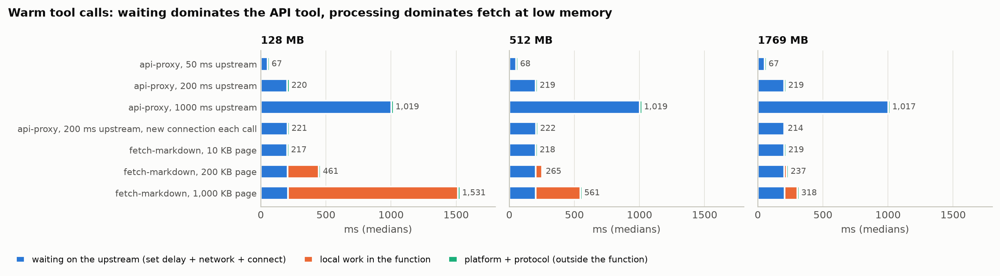
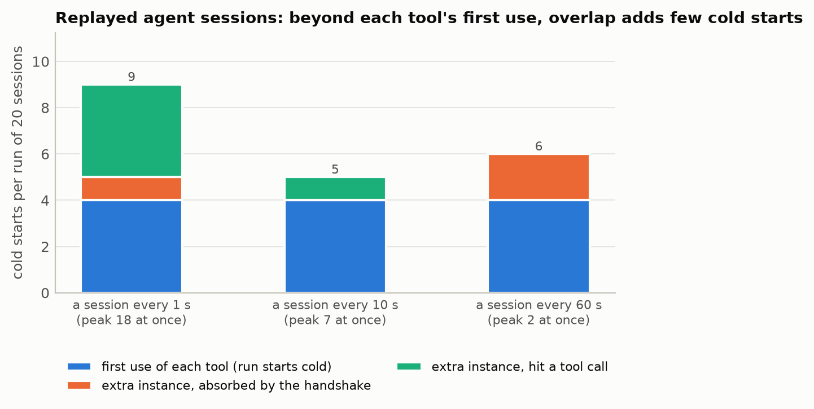
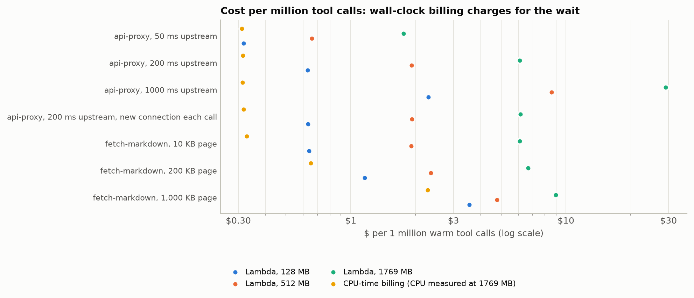

# MCP tools on AWS Lambda: first measurement campaign (2026-11-18)

The first measurements on a real platform. Four MCP tools ran on AWS Lambda at three memory sizes;
the client and the tools' remote API ran on a VM in the same region. The campaign covers the
research questions as follows: Q1 (where a tool call's time goes) by E1 and E3, Q3 (cold starts)
by E2, E1b and E4, Q4 (billing) by E5. Q2 (overlap with LLM calls) is still answered from the trace;
E4 adds the tools' share of session time.

All generated tables: [aws-tables-2026-11-18.md](aws-tables-2026-11-18.md). Raw records: `results/aws/2026-11-18/` (git-ignored).

## Findings

1. **MCP adds almost nothing per tool call, but a session costs 3 extra round trips.**
   A warm MCP `tools/call` is within ±3 ms of a plain invocation of the same function.
   Opening a session (`initialize`, `notifications/initialized`, `tools/list` on a new connection) takes
   48–52 ms from inside the region and 182 ms from ETH Zurich, before the first tool call.
2. **Cold starts are dominated by the tool's own startup, which scales with memory.**
   Lambda's init is 67–79 ms at every memory size. Importing the tool's code takes up to 1.1 s at 128 MB
   and 33–69 ms at 1769 MB. Time to the first result after a cold start: 0.2–1.5 s at 128 MB, 0.2–0.53 s at 1769 MB.
3. **The handshake absorbs Lambda's init, not the tool's import.** SeBS imports the benchmark at its first
   call, so the first `tools/call` still pays for it. A cold MCP session reaches its first result 25–75 ms
   later than a cold plain invocation: the handshake's round trips.
4. **An API-wrapper tool's call time and bill are the upstream's latency plus a constant.**
   At every memory size: call = upstream delay + 17–20 ms; billed duration = upstream delay + 4–7 ms (p99 ≤ 12 ms).
   About 99% of the billed time is spent waiting; the tool uses under 1 ms of CPU per call.
5. **Wall-clock billing charges for the wait, so memory size is a cost decision per tool.**
   The API tool at 200 ms costs $0.63 per million calls at 128 MB and $6.10 at 1769 MB, for the same latency;
   CPU-time billing of the same work would cost $0.32. The fetch tool is the opposite case: at 128 MB it gets
   ~6% of a CPU, and a 1 MB page takes 1.5 s instead of 0.3 s.
6. **Lambda bills its init phase.** On every one of the 319 cold invocations, billed duration = handler duration + Init Duration
   (p50 77 ms), rounded up to the millisecond. About 115–125 ms more of the cold start the client sees is neither reported as init nor billed.
7. **Agent sessions trigger few cold starts at these arrival rates.** In replayed sessions, tools are busy ~3% of
   session time, so 18 concurrent sessions needed only 8 instances across 4 tools. Beyond each tool's first use,
   overlap added 1–5 cold starts per 20 sessions. Sessions arriving further apart than Lambda's idle timeout
   (minutes) are not covered yet.

## Setup

| | |
|---|---|
| Platform | AWS Lambda, eu-north-1 (the only region the account's organization policy allows), Python 3.11, x86_64, zip packages built by SeBS with our patch |
| Trigger | Lambda Function URLs (no API Gateway); the same URL serves MCP and plain invocations |
| Memory sizes | 128 MB (SeBS default, ~1/14 vCPU), 512 MB, 1769 MB (1 full vCPU) |
| Tools | `010.sleep` with 0 s (no-op), `110.dynamic-html` (light compute, imports jinja2), `610.api-proxy` (REST API wrapper), `620.fetch-markdown` (fetch a page, convert to markdown) |
| Client | `mcp_bench.client` on an EC2 t3.small in eu-north-1a: keep-alive HTTPS, `TCP_NODELAY`. E1 also from the ETH workstation |
| Upstream | `mcp_bench.mock_upstream` on the same VM, plain HTTP, configured delay and response size |
| Cold starts | Forced by changing an environment variable of the function (as SeBS does); all 276 forced sessions started cold |
| Billing data | Lambda REPORT lines from CloudWatch, matched to every request by `x-amzn-RequestId` (7,243 of 7,243 client records, 912 of 912 replay invocations) |
| Volume | 8,155 invocations in 54 minutes (12:48–13:42 UTC) |

Changes made for this campaign: the AWS wrapper reports `cpu_us` (process CPU time of the tool call) and
`import_us` (time to import the benchmark module); the client records Lambda request IDs, the tools'
own measurements, timestamps, and takes `--interval` and `--meta`.

## E1 · MCP vs plain invocation, warm (Q1)

200 calls per mode per cell, interleaved in chunks of 50; client in the same region.

| memory | tool | MCP p50 | plain p50 | MCP − plain | in function (MCP) | outside the function |
|---|---|---|---|---|---|---|
| 128 MB | no-op | 19.7 ms | 19.7 ms | −0.1 ms | 0.1 ms | 19.4 ms |
| 128 MB | dynamic-html | 24.4 ms | 22.6 ms | +1.8 ms | 9.3 ms | 15.5 ms |
| 512 MB | no-op | 14.3 ms | 11.2 ms | +3.1 ms | 0.1 ms | 14.2 ms |
| 512 MB | dynamic-html | 16.3 ms | 14.7 ms | +1.6 ms | 1.4 ms | 14.9 ms |
| 1769 MB | no-op | 12.0 ms | 13.8 ms | −1.7 ms | 0.1 ms | 12.0 ms |
| 1769 MB | dynamic-html | 15.3 ms | 14.3 ms | +1.0 ms | 1.3 ms | 14.0 ms |

- The protocol difference is within ±3 ms and changes sign; the MCP response is twice the size (the result is sent both as text and as `structuredContent`).
- Everything outside the function (network, Function URL front end, Lambda routing) costs 12–20 ms per call in-region, an order of magnitude more than MCP.
- From the ETH workstation, a warm call takes 59.5 ms (MCP) vs 59.2 ms (plain).



| new session, warm function (medians) | connect | initialize | notification | tools/list | handshake | first tools/call |
|---|---|---|---|---|---|---|
| client in eu-north-1 (128 / 512 / 1769 MB) | 5–7 ms | 14 ms | 14 ms | 13–17 ms | 48–52 ms | 13–20 ms |
| client at ETH Zurich (128 MB) | 60 ms | 40 ms | 41 ms | 40 ms | 182 ms | 40 ms |

The notification is a full round trip although it has no response body. A client that does not wait for
its `202 Accepted` would save one round trip per session.

## E2 · Cold starts (Q3)

10 forced cold starts per cell and mode, at each memory size; a session is the handshake plus 5 calls (MCP) or 5 calls (plain).



| time to first result after a cold start (p50) | 128 MB | 512 MB | 1769 MB |
|---|---|---|---|
| no-op, MCP / plain | 274 / 217 ms | 272 / 197 ms | 254 / 208 ms |
| dynamic-html, MCP / plain | 1,402 / 1,372 ms | 484 / 436 ms | 331 / 272 ms |
| api-proxy, MCP / plain | 1,074 / 1,046 ms | 563 / 511 ms | 495 / 456 ms |
| fetch-markdown, MCP / plain | 1,517 / 1,493 ms | 650 / 624 ms | 527 / 484 ms |
| Lambda Init Duration (all tools) | 72–79 ms | 67–79 ms | 67–78 ms |
| tool import, dynamic-html / api-proxy / fetch-markdown | 1,056 / 537 / 614 ms | 221 / 104 / 118 ms | 66 / 35 / 42 ms |

- **Platform part:** the no-op's cold penalty (first result − warm call) is 183–257 ms at every memory size.
  Only ~70 ms of it is reported as Init Duration; the rest (sandbox placement and routing) is invisible in the logs and not billed.
- **Tool part:** importing the tool's modules shrinks ~15× from 128 MB to 1769 MB, matching the CPU share.
  610 and 620 import only standard-library modules (`http.client`, `html.parser`, `json`) and still take 0.5–0.6 s at 128 MB.
- **MCP vs plain:** the cold MCP session is 25–75 ms slower to its first result: the handshake round trips. Lambda's init lands on `initialize`.
  The tool import still lands on the first `tools/call`, because SeBS imports the benchmark lazily. A real MCP server imports its tools
  at startup, which would move this cost into Lambda's (billed) init and into the handshake. Worth measuring as a wrapper variant.
- In none of the 120 cold MCP sessions did the first `tools/call` reach a different instance than `initialize`.

## E1b · Extra instances under one sequential client (Q3)

After a forced cold start, one client sends a handshake and 40 calls, one at a time, with a fixed gap. 4 runs per cell.

| | gap 0 | gap 0.25 s | gap 1 s |
|---|---|---|---|
| 128 MB | **2 instances in 4/4 runs** (2nd from ~call 16) | 1 | 1 |
| 512 MB | 1 | 1 | 1 |
| 1769 MB | 1 | 1 | 1 |

At 128 MB, back-to-back requests make Lambda start a second instance (with its own cold start), and later
requests alternate between the two. The likely cause is that the CPU-starved instance is not yet free when
the next request arrives. Agents leave seconds between tool calls, so this matters little for them,
but it is a source of unexpected cold starts on the smallest memory size.

## E3 · Where a warm tool call's time goes (Q1)

30 warm calls per configuration (first 2 of each run dropped).



| median, ms | 128 MB | 512 MB | 1769 MB |
|---|---|---|---|
| api-proxy, 200 ms upstream: total | 220 | 219 | 219 |
| … upstream network + HTTP beyond the delay | 3.3 | 3.6 | 2.9 |
| … new upstream connection (plain HTTP) | 1.4 | 1.4 | 1.2 |
| … outside the function | 16 | 15 | 16 |
| fetch-markdown, 200 KB page: local work | 235 | 48 | 19 |
| fetch-markdown, 1 MB page: local work | 1,304 | 339 | 97 |
| fetch-markdown, 1 MB page: CPU time | 80 | 104 | 98 |

- The API wrapper's call is its upstream's latency plus ~18 ms, independent of memory.
- The fetch tool's local work scales with page size and inversely with memory; its CPU time does not change.
  At 128 MB it receives ~6% of a CPU (80 ms of CPU over 1.3 s).
- The upstream is plain HTTP, so a new connection costs ~1.4 ms; a TLS API would cost tens of milliseconds more per new connection.

## E4 · Replayed agent sessions (Q2, Q3)

The LiveMCPBench trace (Claude Sonnet 4 run) at 512 MB: 20 sessions per run, 214 tool calls, modeled LLM time between turns,
sessions starting 1, 10 or 60 s apart. Each run starts with no warm instances. Sessions connect to all their servers at start.



| a session every | peak concurrent sessions | cold starts: first use / extra on handshake / extra on tool call | instances (4 tools) | tool call p50 / p95 | cold tool call p50 | tool share of session time |
|---|---|---|---|---|---|---|
| 1 s | 18 | 4 / 1 / 4 | 8 | 66 / 382 ms | 397 ms | 3.1% |
| 10 s | 7 | 4 / 0 / 1 | 6 | 67 / 367 ms | 508 ms | 2.7% |
| 60 s | 2 | 4 / 2 / 0 | 6 | 67 / 384 ms | – | 2.7% |

- Tools are busy ~3% of a session's time, so many concurrent sessions share few instances: 18 at once needed 8.
- With eager connection, most cold starts land on the handshake. Under heavy overlap, some hit tool calls (cold tool calls take 0.4–0.5 s vs 66 ms warm).
- Not covered: sessions arriving minutes or hours apart, beyond Lambda's idle timeout. There every session would start
  cold on every tool it uses. This needs an idle-time experiment (call, wait *t*, call again) for *t* of several minutes.
- Billing: handshake requests are 30% of all invocations but 2.4% of billed GB-s, together 8.8% of the Lambda bill
  (mostly per-request fees). The whole replay costs $0.013 per 1,000 sessions at 512 MB with this mock upstream.
  The replay driver's handshake is `initialize` + notification; with `tools/list` it would be 3 requests per server.

## E5 · Billing (Q4)

Warm calls of E3 joined with their REPORT lines. Lambda: billed duration × memory at $0.0000166667 per GB-s
plus $0.20 per million requests (eu-north-1, x86, AWS price list of 2026-11-11). CPU-time billing:
the same calls' measured CPU time at Cloudflare Workers' Standard rates ($0.02 per million CPU-ms plus
$0.30 per million requests, beyond the included quota). This compares billing models on identical work;
it is not a measurement of Workers.



| $ per million warm calls | Lambda 128 MB | Lambda 512 MB | Lambda 1769 MB | CPU-time billing |
|---|---|---|---|---|
| api-proxy, 50 ms upstream | 0.32 | 0.66 | 1.75 | 0.31 |
| api-proxy, 200 ms upstream | 0.63 | 1.92 | 6.10 | 0.32 |
| api-proxy, 1000 ms upstream | 2.30 | 8.58 | 29.14 | 0.32 |
| fetch-markdown, 10 KB page | 0.64 | 1.91 | 6.10 | 0.33 |
| fetch-markdown, 200 KB page | 1.16 | 2.36 | 6.67 | 0.65 |
| fetch-markdown, 1 MB page | 3.56 | 4.77 | 8.98 | 2.27 |

- **Predictability:** for the API wrapper, billed duration = upstream delay + 4–7 ms at p50 and at most +12 ms at p99,
  at every memory size. Its bill can be computed in advance from the upstream API's latency distribution and the memory size.
  For the fetch tool it depends on page size and, strongly, on memory (p99 at 128 MB is 280 ms above p50 for 1 MB pages).
- **Fit of the billing model:** for network-bound tools, 95–100% of what Lambda bills is waiting. At 1769 MB a 1 s API call costs
  91× what the CPU work would cost under CPU-time billing; at 128 MB, 7×. The smallest memory is cheapest for waiting tools.
  For CPU-bound tools, small memory is still cheapest per call but much slower (1 MB fetch: $3.56 and 1.5 s at 128 MB, $4.77 and 0.55 s at 512 MB).
- **Session overhead:** each handshake request is billed 1–2 ms, so its cost is mostly the per-request fee.
- **Cold starts:** the init phase is billed, on every cold invocation (p50 77 ms, at every memory size); the tool's import inside the first call is billed as handler time.

## Caveats

- One region, one day, one client VM. Repetitions suffice for medians (10 cold sessions and 30 warm calls per cell), not for tail latencies.
- 128 MB is CPU-starved; real deployments of heavier MCP servers would use more memory.
- SeBS imports the tool lazily; a real MCP server imports at startup. Totals are comparable, the attribution differs (see E2).
- The mock upstream is plain HTTP; real APIs use TLS.
- In the replay, LLM time is modeled from token counts (400 ms TTFT, 20,000 tok/s prefill, 60 tok/s decode), not measured.
- The CPU-time billing comparison applies Cloudflare's prices to CPU time measured on Lambda.

## Next

1. **Idle-time experiment** (call, wait 1–30 min, call): the cold-start rate of sparse agent traffic, the case E4 does not reach.
2. **Eager-import wrapper variant**: import the tool at startup, as real servers do, and re-measure E2 and its billing.
3. **Browser tool** (Chromium as a container image): the heaviest cold start and in-memory session state.
4. **A CPU-billed platform** to test finding 5 directly (Cloudflare Workers is not supported by SeBS), and Azure/GCP through SeBS.
5. More traces with real timestamps, to replace the modeled LLM time.

## Reproduce

```bash
# needs AWS credentials, the SeBS venv, functions deployed by SeBS, and the VM running the mock upstream
serverless-benchmarks/python-venv/bin/python experiments/aws_campaign.py \
    --vm ubuntu@<vm> --key <key.pem> --upstream http://<vm>:8080 --campaign <id> \
    --memory 128,512,1769 --experiments e2,e1b,e1,e3
serverless-benchmarks/python-venv/bin/python experiments/aws_campaign.py ... --memory 512 --experiments e4
serverless-benchmarks/python-venv/bin/python experiments/aws_campaign.py ... --experiments logs
serverless-benchmarks/python-venv/bin/python analysis/aws_results.py results/aws/<id> --figures docs/figures/aws
```
