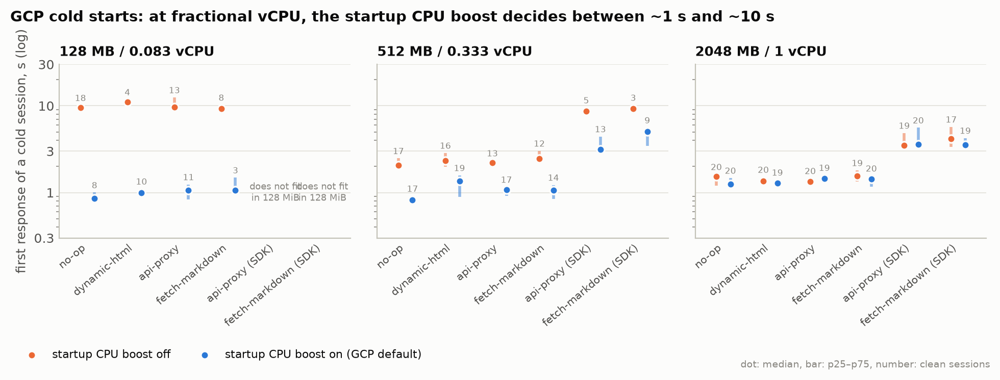

# MCP tools on GCP (Cloud Run functions gen2): campaign of 2026-11-20

The second platform. The same four tools as on AWS, plus the official-SDK variants of `610`/`620`.
They ran at three CPU/memory tiers, with the startup CPU boost on and off; client and mock upstream ran on a VM
in the same region. Analysed 2026-11-22 with `analysis/gcp_results.py`.

All generated tables: [gcp-tables-2026-11-20.md](gcp-tables-2026-11-20.md). Figures: `figures/gcp/`.
Raw records: `results/gcp/2026-11-20/` (git-ignored). AWS numbers below are quoted from [aws-results.md](aws-results.md);
the AWS raw data isn't on this machine.

## Findings

1. **SeBS's way of forcing a cold start doesn't carry over to GCP.** SeBS redeploys the function, but Cloud Run
   starts instances as soon as a revision is deployed, before any request arrives (`DEPLOYMENT_ROLLOUT`).
   Over the campaign that was 4,526 rollout starts against 1,616 request-triggered ones; usually 1 per revision,
   but up to 20 when a revision inherited the previous one's instance count. A request right after a deploy finds
   a booted instance that has already imported the tool. Getting a cold start the client actually sits through
   took holding that instance busy (`X-Sebs-Hold-S`) and a log check per session. After moving aside
   the failed attempts, 477 of 487 sessions pass the check; at 128 and 512 MB that leaves 1–19 sessions per cell.
   For a benchmark suite, this means that a cold start is not one well-defined event across platforms.
2. **At fractional vCPU, the startup CPU boost (on by default) decides between a ~1 s and a ~10 s cold start.**
   First response of a cold session, boost off / on (medians, MCP and plain pooled):
   128 MB / 0.083 vCPU: 9.3–11.0 s / 0.86–1.07 s; 512 MB / 0.333 vCPU: 2.0–2.5 s / 0.8–1.4 s;
   2048 MB / 1 vCPU: 1.3–1.6 s / 1.3–1.5 s (no effect). Almost all of it passes before the container accepts a
   connection: 8.7 s for the no-op at 0.083 vCPU without boost, while importing the tool takes ≤ 0.2 s.
   It's Python and functions-framework booting on a twelfth of a CPU, not the tool.
   
3. **Even at 1 vCPU, GCP cold starts are 3–5× AWS's.** For the stdlib tools, time to the first result is 1.3–1.7 s at
   2048 MB / 1 vCPU, against 0.25–0.53 s on Lambda at 1769 MB (Lambda init ~70 ms).
4. **The realistic SDK stack makes cold starts seconds long, and doesn't fit the smallest tier.**
   functions-framework + `mcp==2.3.0` needs 134 MiB (OOM at 128 MiB). At 1 vCPU, the SDK import alone takes
   2.2–2.7 s (on the laptop: 0.47 s), and the cold first response is 3.5–4.2 s; at 512 MB without boost it's 8.7–9.3 s.
   The SDK has not been run on AWS yet.
5. **After a cold start, one sequential client's requests often spread over several new instances.** Sessions served by
   more than one instance (request log), plain / MCP: 128 MB without boost 16/24 and 5/19, with boost 2/19 and 0/13;
   512 MB 26/80 and 2/75; 2048 MB 6/119 and 2/113. Each extra instance is another cold start, ~9 s at 0.083 vCPU without boost.
   In the MCP sessions that spread, the handshake's later requests hit those instances before the first tool result:
   `110` and `620` reached it after ~20 s (n = 2–3) instead of ~10 s. Why plain sessions spread so much more often than
   MCP ones is not established. On Lambda, no session's first tool call went to a second instance (0 of 120).
   Indicative: few clean sessions in the 128 MB cells.
6. **Warm calls: MCP costs nothing measurable, but the smallest tier stalls.** MCP vs plain is within ±0.8 ms
   (AWS ±3 ms); the path outside the function is 10–16 ms in-region (AWS 12–20 ms). At 128 MB / 0.083 vCPU warm calls
   are bimodal, ≈11 ms or ≈90 ms: 46% of no-op and 68% of dynamic-html calls take ≥ 60 ms (0% at the larger tiers),
   and the warm handshake takes 107 ms instead of 44–47 ms. That pattern matches CPU-quota throttling in
   100 ms periods (not verified directly). Lambda at 128 MB (~0.07 vCPU) has no such stalls: no-op p50 19.7 ms.
7. **API tool = upstream latency + 13–17 ms at 0.333 and 1 vCPU**, as on AWS (+17–20 ms at every size). At 0.083 vCPU
   it's +16 ms at 50 ms upstream, +22 ms at 200 ms and +83 ms at 1 s, almost all of it outside the handler. The fetch tool's local work scales
   inversely with CPU: a 1 MB page takes 2.0 s at 0.083 vCPU, 0.58 s at 0.333, 0.34 s at 1 vCPU.
8. **Billing granularity punishes the MCP handshake** (computed; prices and rounding rule still to verify, see Caveats).
   Cloud Run rounds each request up to 100 ms (Lambda: 1 ms). A 207 ms API call is billed 300 ms, so 16–60% is added
   for calls of 50–200 ms. Each handshake request does 2–6 ms of work and is billed 100 ms, so 300 ms per session.
   In the replay, handshake requests are 30% of invocations, 18–20% of billable time and 23–24% of the
   cost; on Lambda they were 2.4% of GB-s and 8.8% of the bill. MCP 2026-07-28 drops the handshake, so on GCP
   the protocol revision is a cost question, not only a latency one.
   *Note (2026-11-23):* the AWS replay ran at 512 MB whereas GCP ran at 128 MB (where the official SDK OOMs on Cloud Run), so replay billing shares are not 1:1 comparable across clouds until both run at matched tiers. Cloud Run `europe-west1` list prices (`$0.000024/vCPU-s`, `$0.0000025/GiB-s`, `$0.40/M` requests) and 100 ms request-based rounding were verified on 2026-11-23.
9. **Replayed agent sessions (128 MB, boost on):** with a session every second (18 concurrent), the 4 tools used
   15 instances. 7 were pre-started by the deploy and 8 started by requests; only 3 requests had to wait for an
   instance to boot. At 10 s and 60 s arrivals, 5 and 4 instances. Tools are busy 4–5% of session time.
   Not comparable 1:1 with AWS's replay, which ran at 512 MB.

## Setup

| | |
|---|---|
| Platform | Cloud Run functions (gen2, `function-gen2`), europe-west1, Python 3.11, deployed by SeBS with our patch |
| Concurrency | 1 request per instance (`gcp-concurrency: 1`), like Lambda. GCP's default is 80; not measured |
| CPU | `cpuIdle: true` (CPU only during requests; request-based billing) |
| Tiers | Cloud Functions' default CPU per memory: 128 MB / 0.083 vCPU, 512 MB / 0.333, 2048 MB / 1 (Lambda: ≈0.07 / 0.29 / 1 at 128 / 512 / 1769 MB) |
| Startup CPU boost | measured off and on in E2; on elsewhere (GCP's default) |
| Tools | `010.sleep` (no-op), `110.dynamic-html`, `610.api-proxy`, `620.fetch-markdown`; SDK variants of 610/620 at ≥ 512 MB |
| Client and upstream | `mcp_bench.client` and `mcp_bench.mock_upstream` on an e2-small VM in europe-west1-b; E1 also from the workstation |
| Cold starts | new revision via the Cloud Run API, then the pre-started instance is held busy; sessions kept only if `experiments/gcp_session_check.py` finds the first request started a new instance itself |
| Platform data | Cloud Run request log (instance, latency, status per request, joined by trace ID: 7,824 of 7,824 client records) and system log (instance starts with reason, startup probes) |

## Caveats

- **Billing computed from published list prices, not GCP invoices.** Prices for `europe-west1` (`$0.000024/vCPU-s`, `$0.0000025/GiB-s`, `$0.40/M` requests) and 100 ms rounding were verified on 2026-11-23; billable time is approximated by request-log latency, which includes the front end.
- Cloud Run's request-log latency is not reliable for cold starts: it left out most of the startup in the campaign's
  held sessions but included it for natural cold starts after idling (2026-11-22). Cold-start times come from the
  client and the startup-probe timestamps.
- **Validation of E2 (2026-11-22):** natural cold starts after idling (instance started by the request, per the system
  log) match the held sessions: 128 MB / 0.083 vCPU without boost 9.7 s (no-op) and 8.8 s (dynamic-html) vs 9.4–11.2 s
  in E2; SDK tools at 512 MB with boost 3.1 and 5.1 s vs 3.4–4.6 s. Details: progress.md, 2026-11-22 (afternoon).
- `cpu_us` has 10 ms resolution on Cloud Run: per-call CPU is reported as a mean.
- Clean cold sessions are few at 128 MB (1–18 per cell) and in E1b (1–4 runs per cell); the multi-instance finding (5)
  and E1b are indicative.
- One region, one day, one client VM. The E4 replay ran at 128 MB on GCP and at 512 MB on AWS.
- The SDK plain path doesn't report its startup import time; the MCP path does.

## Reproduce

```bash
serverless-benchmarks/.venv/bin/python experiments/gcp_session_check.py results/gcp/2026-11-20
serverless-benchmarks/.venv/bin/python analysis/gcp_results.py results/gcp/2026-11-20 --figures docs/figures/gcp
cp results/gcp/2026-11-20/summary.md docs/gcp-tables-2026-11-20.md
```
