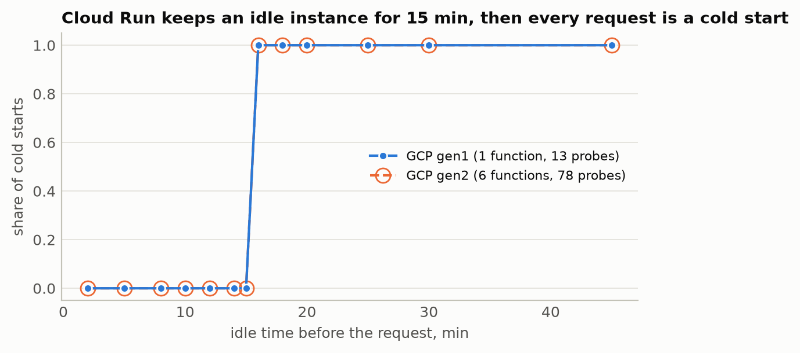

# Idle-time experiment: how likely is a cold start after t minutes without requests?

Agent traffic is sparse between sessions: a tool may be called again minutes or hours later. E4 (replay) never
idles long enough to see that. This experiment measures, per platform, the share of cold starts as a function of
the idle time before a request. Combined with E2's cold-start cost per tool, that gives the expected extra latency
of a tool call for a given call rate.

It also gives natural cold starts (after idling), the ground truth for checking how a platform's cold start
compares with the forced ones SeBS uses.

## Design

- One **chain** per function: probe, stay idle for *t*, probe again; *t* from a shuffled schedule (same grid on
  every platform). Chains run in parallel; a function's instances only see its own chain.
- A **probe** is what an agent does when it comes back to a tool: a new connection and an MCP session
  (handshake + `calls` tool calls), or plain invocations for `"mode": "plain"` targets.
- **Cold** = the wrapper's `is_cold` on the probe's first request (fresh process). Same field on AWS, GCP and Azure.
- Idle time is measured from the end of the previous probe. Probe 0 of a chain is not counted.
- The driver (`experiments/idle_probe.py`) only needs the functions' URLs, uses only the standard library, and
  resumes after a restart (rerun the same command).

## Running it on AWS

1. Functions: the four tools deployed by SeBS as in the 2026-11-18 campaign (Function URLs), at **512 MB**
   (all tools on GCP run at 512 MB / 0.333 vCPU, boost on). If the SDK variants are deployed, add them too.
   Don't redeploy or update the functions during the run: an update makes the next request cold.
2. A targets file, e.g. `configs/idle.aws.json` (git-ignored: the URLs are public endpoints):

   ```json
   [
    {"name": "aws-010", "url": "https://<id>.lambda-url.eu-north-1.on.aws/", "mode": "plain", "calls": 1, "arguments": {"sleep": 0}},
    {"name": "aws-110", "url": "https://...", "mode": "mcp", "calls": 1, "arguments": {"username": "agent", "random_len": 100}},
    {"name": "aws-610", "url": "https://...", "mode": "mcp", "calls": 0, "arguments": {}},
    {"name": "aws-620", "url": "https://...", "mode": "mcp", "calls": 0, "arguments": {}}
   ]
   ```

   `calls: 0` = handshake only (initialize, notification, tools/list): no upstream needed.
3. On the EC2 VM (so the laptop can sleep), from the repository copy (`mcp_bench/`, `experiments/idle_probe.py`, the targets file):

   ```bash
   nohup python3 experiments/idle_probe.py --targets configs/idle.aws.json --out results/idle/aws-<date> \
       --gaps <same grid as GCP, see below> --seed <date> > results/idle/aws-<date>.log 2>&1 &
   tail -f results/idle/aws-<date>.log
   ```

   Duration ≈ the sum of the gaps (all chains run in parallel). A quick check first: `--gaps 0.1 --out results/idle/smoke`.
4. Optional, for the Init Duration of each cold probe: the REPORT lines from CloudWatch, as `aws_campaign.py logs` does.
5. Copy `results/idle/aws-<date>/` back and run
   `serverless-benchmarks/.venv/bin/python analysis/idle_results.py results/idle/aws-<date> --figures docs/figures/idle`.

## Running it on GCP

```bash
# services: 512 MB / 0.333 vCPU / boost on (experiments/gcp_configure.py); 010 gen1 and gen2 as SeBS deploys them
ssh mcpbench@<vm> 'cd ~/mcpbench && nohup python3 experiments/idle_probe.py --targets configs/idle.gcp.json \
    --out results/idle/gcp-<date> --gaps <grid> --seed <date> > results/idle/gcp-<date>.log 2>&1 &'
# afterwards, locally: copy results/idle/gcp-<date>/ back, then fetch Cloud Run logs into it
GOOGLE_APPLICATION_CREDENTIALS=<key> serverless-benchmarks/.venv/bin/python experiments/gcp_logs.py \
    --since <start> --out results/idle/gcp-<date> --service 010=<service> ...
serverless-benchmarks/.venv/bin/python analysis/idle_results.py results/idle/gcp-<date> --figures docs/figures/idle
```

## Gap grid

**`--gaps 2,5,8,10,12,14,15,16,18,20,25,30,45`** (minutes, ≈ 3.7 h), the same on every platform. Dense between
10 and 20 min, where Cloud Run's documented idle limit (up to 15 min) is. If time allows on AWS, also run
`--gaps 1,3,30` (as the GCP pilot did), for the short end and a third sample at 30 min.

GCP pilot, 2026-11-22 (`results/idle/pilot`): at 1 and 3 min 14/14 probes warm; at 30 min 7/7 cold, all 6 gen2
ones on an instance started by the probe's request.

## Results: GCP, 2026-11-22

Run 14:51–18:32 UTC, `results/idle/gcp-2026-11-22` (tables: its `summary.md`), 7 functions × 13 gaps, 0 errors.
Cloud Run logs joined for the 6 gen2 functions.



1. **A sharp edge at 15 minutes.** Up to 15 min idle: 49 of 49 probes warm (first request 34–40 ms). From 16 min:
   42 of 42 cold. No probabilistic region, the same on gen1 and gen2 and for every tool. Matches Cloud Run's
   documented idle limit of up to 15 min. Every gen2 cold probe (36) ran on an instance its own request started
   (AUTOSCALING, system log): natural, request-triggered cold starts.
2. **Natural cold starts at 512 MB / 0.333 vCPU, boost on** (first request, i.e. time to first result for calls ≤ 1):
   no-op 0.79–1.0 s, `110` 0.84–1.23 s, `610`/`620` handshake 0.72–1.10 s; **SDK variants 3.1–6.1 s**
   (610 SDK 5.4–6.1 s, 620 SDK 3.1–5.4 s). Consistent with E2 (512 MB, boost on: 0.8–1.4 s; SDK 3.4–4.6 s).
3. **SeBS's forced cold start overstates gen1's natural one.** gen1 `010.sleep` after idling: 0.76–0.97 s in 5 of 6
   probes (one 2.2 s), median 0.92 s. SeBS `perf-cost` cold (forced by redeploying): 2.1–2.5 s (8 of 8).
   gen2: forced ≈ natural (~1 s).
4. **Consequence for agents:** a tool called less often than every 15 min pays a cold start on every call;
   above that, never (at concurrency 1 with one client). On GCP at 0.333 vCPU that is ~1 s for a light tool
   and 3–6 s with the official SDK.

### 630.data-analysis (heavy startup), natural cold starts, boost on

`results/idle/gcp-630-2048` (2048 MB / 1 vCPU) and `results/idle/gcp-630-512` (512 MB / 0.333 vCPU), 6 probes per
variant and tier after 17 min idle (handshake + 3 calls). All 24 cold, each on an instance its own request started
(system log); all requests 200/202. Time to the first tool result:

| tier | variant | time to first result | import | dataset load (1 MB, 200 ms upstream) | warm calls |
|---|---|---|---|---|---|
| 2048 MB / 1 vCPU | default (shim + pandas) | 3.3–6.4 s (median 5.0) | pandas 2.1–5.0 s, in the first call | 0.26–0.31 s | 20–37 ms |
| 2048 MB / 1 vCPU | SDK + pandas | 6.2–9.0 s (median 6.4) | 4.6–7.4 s, at instance start | 0.44–0.46 s | 28–36 ms |
| 512 MB / 0.333 vCPU | default (shim + pandas) | 3.9–7.8 s (median 6.1) | 2.5–5.8 s, in the first call | 0.28–0.33 s | 27–40 ms |
| 512 MB / 0.333 vCPU | SDK + pandas | 5.4–10.8 s (median 6.8) | 3.9–9.0 s, at instance start | 0.42–0.46 s | 24–30 ms |

- **A heavy tool costs 5–7 s per cold start on GCP**, against 1.3–1.7 s for the stdlib 610/620 and 3.5–4.2 s for
  their SDK variants at 1 vCPU (E2). Nearly all of it is importing; the dataset load adds 0.3–0.45 s. On a laptop
  the pandas import takes 0.22 s.
- **With the boost on (GCP's default), the tier barely matters:** 0.333 vCPU is only ~1.1–1.2× slower than 1 vCPU
  (medians). Consistent with E2, where the boost removed the difference between tiers. The boost also covers the
  default variant's lazy import in the first call, which comes right after startup. In the smoke test, the same
  import on a pre-started instance, called ~30 s after it started, took 10.4 s: consistent with the boost lasting
  only a short time after startup (Cloud Run documents 10 s), not verified further.
- Import times vary 2× between cold starts on both tiers (e.g. 2.1–5.0 s), so 6 samples give a range, not a
  precise median.
- The default variant imports lazily, so its handshake is fast (0.8–1.6 s) and the first `tools/call` pays the
  import; the SDK variant imports at startup, so the first request does. Either way, the agent waits for it.
