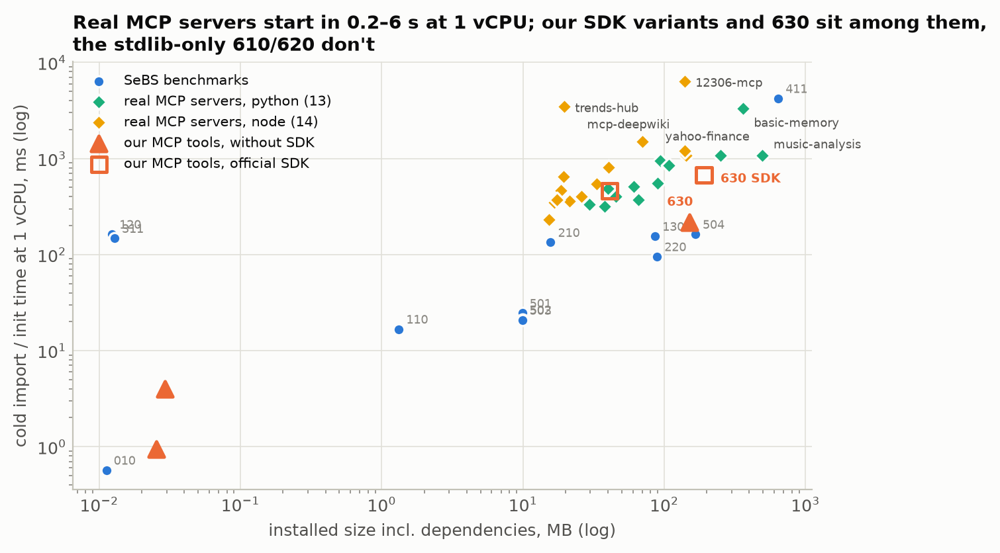

# Real MCP servers: what our tool benchmarks have to look like

The gap comparison (progress.md, 2026-11-19) used our own tools with mock latencies, so it said little about
real tools. Here, 27 real servers from LiveMCPBench's server set are installed and started the way the benchmark
runs them (`uvx …`, `npx …`) and measured on the same axes as the SeBS catalog. Measured 2026-11-22 with
`experiments/real_servers/run.py`; tables: [real-servers-tables.md](real-servers-tables.md); figure:
`figures/real-servers/size-vs-init.png`.

## Findings

1. **Real MCP servers are heavy to start.** Median 42 MB installed (p25–p75: 24–101 MB), 96 dependencies,
   **547 ms to initialise at 1 vCPU** (386–1,075 ms), 87 MB peak memory. Even trivial servers (a calculator,
   the time zone tool, `sequential-thinking`) take 0.3–0.5 s and 30–130 dependencies: the MCP SDK and its stack
   (on Python: pydantic, starlette, anyio, …) cost that before the tool does anything.
   SeBS's benchmarks: median 10 MB and 114 ms import. At similar installed sizes, real servers take 3–10× longer
   to start than `130`, `210`, `220`, `504` (≈100–170 ms), and far more than `501`–`503` (≈20 ms).
2. **Our official-SDK variant is representative, the stdlib variant is not.** The SDK variant of 610/620
   (41 MB, 460 ms) sits at the median of the real servers. The stdlib tools (0.03 MB, 1–4 ms) sit at the
   bottom-left corner with `010.sleep`: they understate cold starts by two orders of magnitude. Cold-start and
   billing results should use the SDK variant; the stdlib variant isolates protocol and platform cost.
3. **Startup is CPU-bound, so it scales with the fractional vCPU of small function sizes.** For 26 of 27 servers,
   the startup's CPU time ≈ its wall time (median 0.54 CPU-s, 0.25–3.3 s). On GCP we measured that 0.083 vCPU
   without boost stretches a ~0.7 CPU-s runtime boot to ~9 s; Lambda at 128 MB has ~0.07 vCPU. A median server
   would need several seconds to start there (an estimate from CPU time, not measured on the platforms).
4. **Some servers fetch data at startup.** `12306-mcp` downloads its station list (2.8 CPU-s, ~6 s);
   `trends-hub` waits on the network during startup (0.5 CPU-s, 0.9–20 s across runs). On a function that
   happens on every cold start, and its time depends on a third party.
5. **Most fit in 128 MB, but only as the bare server.** 23 of 27 peak below 128 MB as a stdio process.
   A function runtime adds its own memory: our SDK variant (75 MiB as a process locally) needed 134 MiB on GCP
   with functions-framework and gunicorn.
6. **3 of 13 Python servers no longer start as the benchmark configures them.** `mcp-simple-arxiv`,
   `office-powerpoint-mcp-server` and `osm-mcp-server` don't pin `mcp<2`; a fresh install gets SDK 2.x, whose API
   they don't match (`FastMCP` renamed, `Server.list_tools` gone). Measured with `mcp<2`. Three others need
   Python ≥ 3.13 (provisioned with uv, as `uvx` does).

## Method

- Servers: LiveMCPBench's configs, all classes, both languages, weighted to those its tasks use; left out:
  servers needing Docker, a desktop, a git install at start, or a remote gateway. List: `configs/real-servers.json`.
- Each server in a throwaway container (`node:22-bookworm-slim` + Debian's Python 3.11; uv for servers needing
  Python 3.13 or pinned extras), `--cpus=1 --memory=2g`, network on (installs, and servers that fetch at startup).
  Third-party code never runs on the host.
- Installed size: the venv (minus an empty one) or `node_modules`; no language runtime, like SeBS's code directory.
- Startup: process start → `tools/list` response over stdio (initialize, notifications/initialized, tools/list);
  7 runs, median of runs 2–7. *Init* = startup − bare interpreter start (`python -c pass`, `node -e 0`, 10–45 ms).
  SeBS's import time (experiments/characterize.py) is the in-process import of the benchmark module.
- Peak RSS and CPU summed over the process tree (`/proc`), read right after tools/list.
- Same laptop as the SeBS numbers, so CPU-speed noise applies to both. Latest package versions as of the run.

## Consequences for the benchmark

- Report cold starts and billing with the SDK variant (or a real server) as the main configuration.
- A tool class we didn't cover stood out: **heavy startup** (basic-memory 3.3 s, 12306 6.4 s; 250–500 MB for
  yahoo-finance and music-analysis). That's the "heavy-import compute" class from the census plan, now with data.
  Built as `630.data-analysis` (pandas + a dataset loaded per instance; progress.md, 2026-11-22 evening).
- Startup network fetches (12306, trends-hub) are a cold-start cost no SeBS benchmark has.
